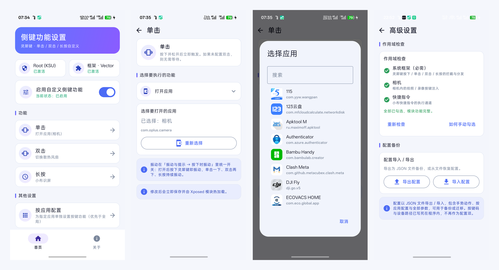

# 灵犀按键自定义

当初就是冲着 OPPO K15 Pro+ 的造型买的，到手最喜欢侧面那颗「灵犀」按键，结果发现它能干的事太少，于是自己写了个 App：基于 Xposed/LSPosed 框架，给灵犀键自定义单击、双击、长按动作，桌面与息屏均可用，游戏内自动放行原厂灵犀功能。按键拦截与动作执行运行在系统框架进程中，设置界面用 Compose 编写。包名 `io.github.a1204507929.lingxikey`。

> 本模块基于 [SlimeNull/OppoCustomSideButtonFunctions](https://github.com/SlimeNull/OppoCustomSideButtonFunctions) 二次开发，
> 针对 OPPO K15 Pro+（ColorOS 16 / Android 16）重新适配了按键拦截点与手势码。在此感谢原作者的出色工作。
>
> **本项目（fork）改动：**
> 1. 适配 OPPO K15 Pro+（重写按键拦截，单击 / 双击 / 长按自定义，游戏模式放行原厂行为）；
> 2. 新增「打开应用」（自选任意 App）、「灯效开关」、「打开游戏助手」、「切换散热风扇」动作；
> 3. 散热风扇改用系统原厂方式控制，切换时与原厂一致，**有流体云胶囊通知**、任务栏磁贴同步；
> 4. 按应用配置：可为指定应用单独设置按键功能（优先于全局）；
> 5. 按下即振动：单击一下、双击两下、长按持续振动（松手停）；
> 6. 全新界面皮肤；功能为「打开应用」时主界面显示为 `打开应用(应用名)`；
> 7. 高级设置：作用域检查与一键申请、配置 JSON 导入 / 导出；
> 8. 首页显示 Root 与框架激活状态，Root 未激活可跳转 GhostLock，框架未生效可一键软重启修复。
>
> 开源地址：<https://github.com/a1204507929/LingXiSideKey>

<div align="center">
  
</div>

## 安装与启用

1. 安装 APK，在 LSPosed/Vector 中启用模块，并将 **Android 系统框架（`android`）** 加入作用域。
2. 重启设备，让系统框架加载模块。只重启 SystemUI 不一定能使框架进程中的按键 hook 生效。
3. 打开“灵犀按键自定义”，保持“启用自定义侧键功能”开启，分别配置单击 / 双击 / 长按动作。设置会自动保存，后续修改无需手动点击保存。

使用“小布快捷指令”时，还可以将 `com.coloros.shortcuts` 加入作用域：打开 ColorOS 快捷指令编辑页面时，模块会尝试把指令 ID 复制到剪贴板。此作用域不是侧键操作本身的必需条件，且依赖对应系统应用的实现。

## 手势与动作

分别配置单击、双击、长按的动作。双击动作设为“不执行操作”时，单击在松开后立即触发；配置双击后，单击会等待第二次按下，默认等待窗口为 300ms。长按在持续按住达到阈值时触发，默认 300ms（100~800ms 可调）；松开后不会再次触发单击。

全局可选动作：

- **声音**：显示响铃 / 振动 / 静音状态、切换响铃 / 振动 / 静音、免打扰开关
- **硬件**：切换散热风扇（原厂通道，切换有流体云胶囊）、灯效开关、手电筒、系统截屏
- **快捷入口**：常用功能（微信 / 支付宝付款码、一键闪记、小布记忆）、执行小布快捷指令、小布识屏、打开游戏助手、**打开应用**（自选任意 App）
- **高级**：自定义 Activity、自定义 Url Scheme、执行 Shell 指令
- **录音**：开始 / 结束录音

“按应用配置”可为指定应用单独设置按键功能（优先于全局）：例如相机前台时的「拍照 / 录制」，音乐应用的播放 / 暂停 / 上下曲，视频应用的快进 / 后退 10 秒。

## 振动与提示

首页“振动与提示”页可配置：

- **按下时振动**：按下灵犀键立即振动——单击振一下、双击振两下、长按持续振动（松手即停）；
- **Toast 提示**：动作执行后显示提示，默认关闭，内容可自定义。

“高级设置”提供作用域检查（结果以 Toast 提示，支持一键申请作用域或跳转框架管理器手动勾选）、
配置导入 / 导出（JSON 格式，包含手势动作、按应用配置与全部参数），以及配置备份。
按键码（`672`，KEY_MACRO17）与输入设备路径（`/dev/input/event2`）已内置在程序中，不再作为配置项。

底部导航的第二个页面为“关于”，展示本项目的开源地址
（`https://github.com/a1204507929/LingXiSideKey`）、原项目信息与改动说明，
并提供 GNU Lesser General Public License v3.0 许可证入口。

## 环境状态

首页标题下方显示两个状态方框：

- **Root (KSU)**：检测 root 是否已激活；未激活时点击可跳转 GhostLock。
- **框架**：显示模块注入状态与已安装的框架管理器名称（Vector / LSPosed）；
  已安装但未生效时点击会询问是否软重启尝试恢复，未安装则提示先安装框架。

## 兼容性与权限

- 模块 hook Oplus 的 `InputKeyEventNotifyService.interceptKeyBeforeQueueing` 拦截链拦截灵犀键事件；
  不可用时回退到读取 Linux 输入设备（内置路径 `/dev/input/event2`）。不同设备或 ROM 的按键实现可能不兼容。
- 按键拦截需要将 **Android 系统框架（`android`）** 加入 LSPosed/Vector 作用域；相机快门需要 `com.oplus.camera` 作用域。
- 免打扰动作需要系统允许修改免打扰状态；若出现权限提示，请检查系统的免打扰访问权限设置。
- 截屏优先使用系统接口，失败后尝试 Shell 命令及 SystemUI 兼容广播；实际可用方式取决于 ROM。
- 自定义 Shell 指令在系统框架进程的后台线程中通过 `su` 执行，不会转发给桌面。设备需具备 Root，且 Root 管理器需允许该进程执行命令。
- 应用启动、特定快捷功能及 Toast 的行为可能受 ROM 限制。

## 构建

需要 Android SDK 和项目 Gradle Wrapper。Windows 下运行：

```powershell
.\gradlew.bat :app:assembleDebug
.\gradlew.bat :app:assembleRelease
```

产物位于 `app/build/outputs/apk/debug/` 或 `app/build/outputs/apk/release/`。
Release 构建使用 `keystore/keystore.properties` 中配置的签名信息；仓库出于安全考虑未包含签名文件，
如需构建 Release 请自行放置 `keystore/custom-side-button.jks` 与 `keystore/keystore.properties`，
或直接使用 Debug 构建。
